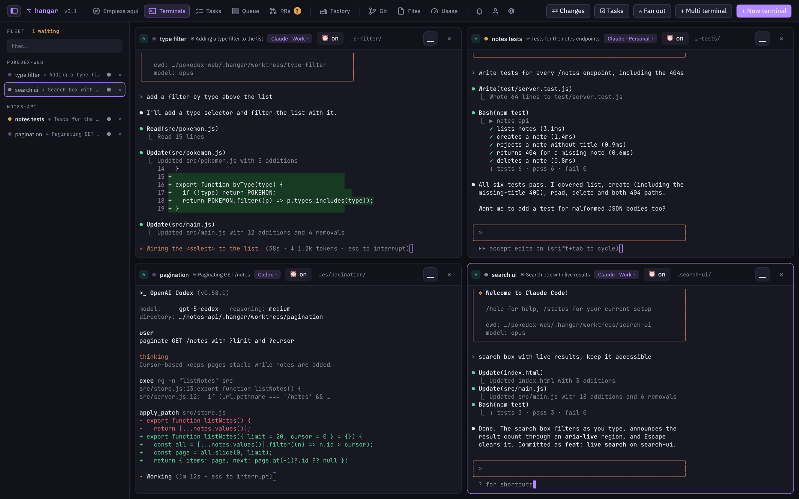
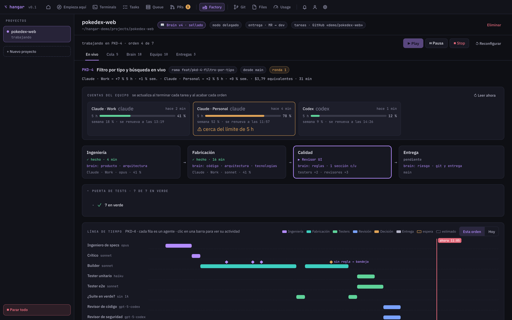
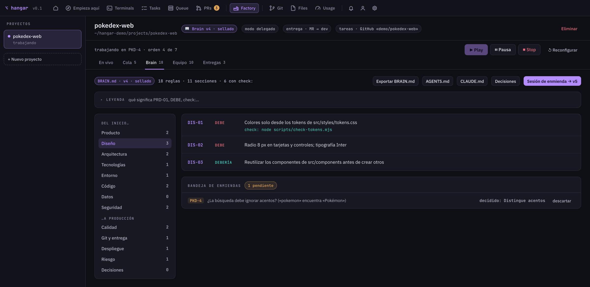
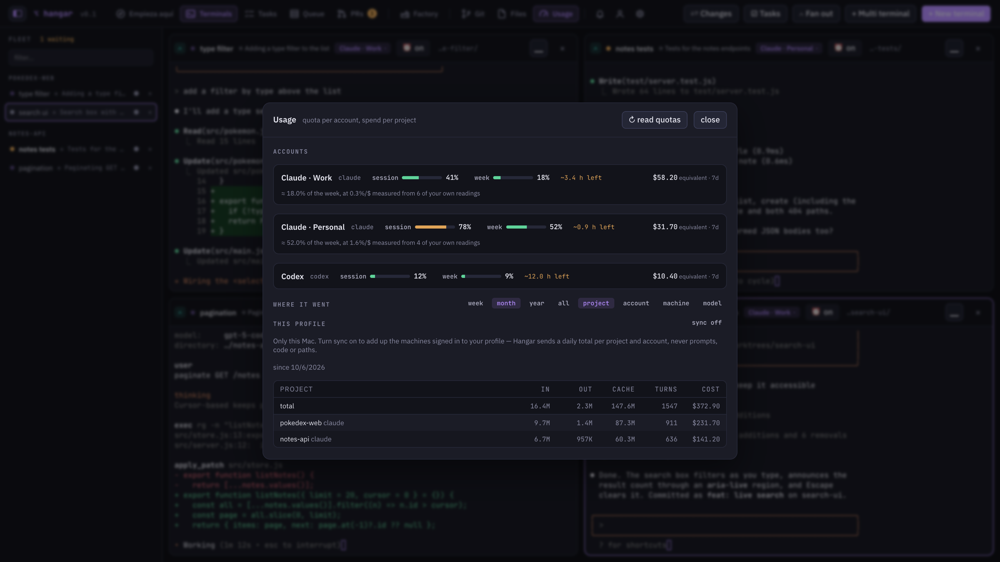
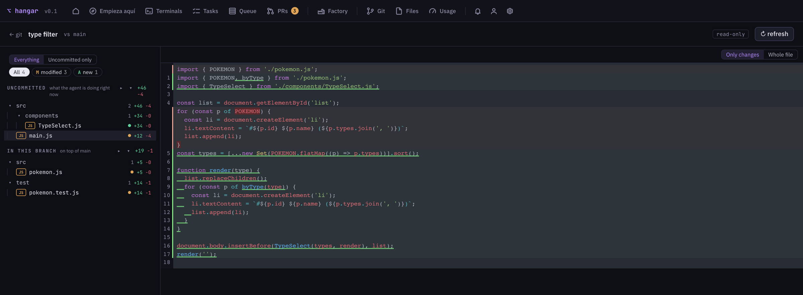
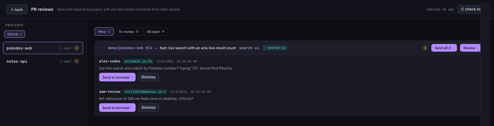

# Hangar

**Mission control for your coding agents.**

A local-first desktop app that runs real agent CLI terminals in parallel — each in its own git
worktree, each under the account it's supposed to use. When an account runs out of quota, Hangar
carries on with another one, keeping the conversation. Your work stays on the machine: state is
SQLite, credentials are in the OS keychain, and no prompt, transcript or file ever leaves.

What does leave is small and nameable: a Google sign-in (Hangar requires an account to open), and,
only if you switch it on, a daily roll-up of spend per project and account — counters, no content.

**Claude Code and Codex** are wired end to end: each gets its own config directory
(`CLAUDE_CONFIG_DIR`, `CODEX_HOME`), and Hangar can tell whether an account is signed in — which is
what scoping a terminal to one account rather than another depends on. **Kimi, Grok and Gemini**
have provider specs and would run, but Hangar can't check their login state yet, so it can't tell
two of their accounts apart. Both the account wizard and the terminal picker mark them "not
supported yet" instead of letting you get halfway in.

## Screenshots

Taken with demo data — two sample projects and three accounts that don't belong to anyone.

**A grid of real agent terminals**, each in its own worktree and under its own account — Claude Code
and Codex side by side, with what each one is doing and whether it's waiting for you.



**The Factory** takes an order from the queue through spec, build, tests, review and delivery. Every
station shows which part of the project's brain it reads, which account it spends, and how much.



**The brain** is the project's rules, sealed and versioned. Rules with a check become part of the test
gate; questions no rule answers wait in the amendments inbox for you to decide.



**Usage per account**, in the unit it's billed in: 5-hour and weekly quota for subscriptions, plus
where the spend went by project, account, machine or model.



**What each worktree changed**, uncommitted and committed, read-only — and **PR review comments**,
sent straight back to the terminal that wrote the code.





## What it does

- **A grid of real terminals** — one PTY each (up to six), spawned through your login shell so they
  behave exactly like typing `claude` in Terminal.app. Minimized terminals keep running, and open
  terminals come back with their conversation after a relaunch.
- **Isolated worktrees** — every subsession works in `.hangar/worktrees/<slug>` on its own branch,
  so parallel agents never fight over the same files.
- **Multi-account, no cross-contamination** — each account gets its own isolated CLI config dir;
  work and personal accounts are separate scopes and are never mixed silently.
- **Capacity** — real 5h/weekly usage read from the CLI, monthly spend caps, and opt-in per-project
  rotation that fails over to another allowed account of the same provider when one is exhausted.
- **Continuity** — a conversation can move between accounts: the transcript is placed where the
  destination CLI looks and resumed there.
- **Governance** — four session modes (`plan` read-only, ask-edits, auto-edit, yolo) plus a
  permission bridge that surfaces each tool call for approval, even in headless turns.
- **Git and PRs** — diffs, branches, PR creation via `gh`, a review inbox, and
  sending PR review comments straight back into a session.
- **Hierarchies and shared memory** — parent agents that spawn children (three levels, three views)
  and memory groups shared across projects.
- **Per-project agent context** — the language an agent answers in and the one it writes code in, set
  globally and overridable per project, plus a library of Agent Skills you pick per project. All of it
  reaches the CLI as spawn flags, so nothing is written into your repository. See
  [AGENT_CONTEXT.md](AGENT_CONTEXT.md).

## Development

Requires Node 22+, a stable Rust toolchain, and the `claude` CLI on PATH for anything that actually
runs an agent.

```sh
cp .env.example .env.local   # then fill in your Supabase project — see below
npm install
npm run tauri dev      # run the app
npm run build          # typecheck + build the frontend
cd src-tauri && cargo test
```

Tests marked `#[ignore]` spawn the real `claude` CLI — run them with `cargo test -- --ignored`.

### Backend (Supabase)

Hangar signs people in, syncs usage totals and checks for updates against a Supabase project, and
the repository doesn't name one: each build brings its own. Put its URL and publishable key in
`.env.local` (git-ignored; Supabase → Project Settings → API):

```sh
VITE_SUPABASE_URL=https://<your-ref>.supabase.co
VITE_SUPABASE_PUBLISHABLE_KEY=sb_publishable_...
```

Both are public by design — row-level security protects the data, not the key. Without them the
app builds and starts, but stops at a "No backend configured" screen.

The project needs Google sign-in enabled, with `http://127.0.0.1:47823` (the fixed loopback port in `src-tauri/src/auth.rs`) as a redirect URL, and the
tables the client reads: `profiles` (with an `approved` flag the gate checks), `subscriptions`,
`machines`, `usage_daily`, `team_accounts` and `account_leases` (plus the `acquire_account_lease` /
`release_account_lease` functions), all with row-level security. `supabase/` holds the update
channel: the `app_releases` migration and the `updates` Edge Function.

Updates: `tauri.conf.json` ships with no update endpoint, so a build never asks anyone's project for
updates by accident. `npm run release` reads the project from `.env.local` and gives the release
build its endpoint (`<project>/functions/v1/updates`); it also needs the project's service-role key
and the updater signing key — see the header of `scripts/release.sh`.

### Building for Windows from a Mac

Tagged releases build Windows on a `windows-latest` runner, but the whole installer can also be
produced locally — useful when CI isn't an option:

```sh
brew install llvm nsis && cargo install cargo-xwin
rustup target add x86_64-pc-windows-msvc
export PATH="/opt/homebrew/opt/llvm/bin:$PATH"
npx tauri build --runner cargo-xwin --target x86_64-pc-windows-msvc --bundles nsis \
  --config '{"bundle":{"createUpdaterArtifacts":false}}'
```

Out comes `src-tauri/target/x86_64-pc-windows-msvc/release/bundle/nsis/Hangar_<version>_x64-setup.exe`.

Two things are deliberate. `--bundles nsis`, because `bundle.targets` is `"all"` and the `.msi`
half of that needs WiX, which only runs on Windows. And the `createUpdaterArtifacts` override,
because signing updater artifacts needs `TAURI_SIGNING_PRIVATE_KEY` — a GitHub secret, not
something a local build has; it's passed as a flag so the committed config CI relies on stays put.

The installer is unsigned, so SmartScreen warns once on first run. The app needs
[Git for Windows](https://git-scm.com/download/win) — not only for worktrees, but because its
`bash.exe` is the shell Hangar's terminals run in (`terminals.rs`, `user_shell`).

`cargo test` cannot run on Windows at all: `tauri-build` doesn't give test binaries the manifest
that pins `comctl32.dll` to v6, so they die before `main` with `STATUS_ENTRYPOINT_NOT_FOUND`
([upstream bug](https://github.com/tauri-apps/tauri/issues/13419)). CI compiles them there and
runs them on macOS.

## Layout

| Path | What's in it |
| --- | --- |
| `src/` | React + TypeScript frontend (screens, components, design tokens) |
| `src-tauri/src/` | Rust backend: commands, PTY terminals, turn runner, rotation, git/PR, SQLite |
| `src-tauri/src/db/schema.sql` | The schema, applied idempotently on startup |
| `src-tauri/tests/fixtures/` | Real captured CLI output used by the parser tests — recorded data, not to be edited |

## Design documents

| Document | What it covers |
| --- | --- |
| [AGENT_CONTEXT.md](AGENT_CONTEXT.md) | How language preferences and skills reach the CLI: where they're configured, where they land on disk, which flag carries them, and what was verified by actually running each CLI |
| [TERMINAL_CONTINUITY.md](TERMINAL_CONTINUITY.md) | How a conversation survives a relaunch and an account switch |
| [MOBILE_BRIDGE_TRD.md](MOBILE_BRIDGE_TRD.md) | The phone companion: protocol, encryption, pairing ([build docs](docs/mobile/README.md)) |
| [GRAPHIFY_TRD.md](GRAPHIFY_TRD.md) | A code knowledge graph shared by parallel agents, spanning the several repos that make up one system. Phases 0–5 are implemented and merged; the graph is optional and Hangar runs without it |
| [ROADMAP.md](ROADMAP.md) | Where this is going |
| [BETA.md](BETA.md) | The private beta: what is left to do and in what order, what it costs, and why TestFlight isn't an option. Supersedes the roadmap on how this is distributed and paid for |

## License

**GNU AGPL-3.0** — see [LICENSE](LICENSE). Copyright © 2026 David Lopez.

Free to use, study, change and share. The one obligation that matters: if you distribute a modified
version, or **run one as a network service**, you have to offer its source under the same terms.

The choice is deliberate. Hangar's edge is that no other agent orchestrator manages accounts —
isolation per account, rotation on exhaustion, the conversation surviving the switch. Every
comparable tool is MIT or Apache-2.0, which would let any of them fold that work into a closed or
permissive product without giving anything back. The AGPL doesn't stop anyone from *using* Hangar; it
stops that.

Two consequences worth knowing up front:

- **A hosted Hangar would have to publish its source** (AGPL §13). A separate team dashboard that
  merely talks to the same database is not a derivative work and isn't covered — but hosting the app
  itself is.
- **Only the copyright holder can relicense.** Contributions are welcome; if this ever needs
  dual-licensing, that conversation has to happen with contributors rather than around them.

## Note on the rename

This project was called **Fleet** until July 2026. The rename is complete, with two deliberate
exceptions kept for compatibility: worktrees created before it still live in `.fleet/` and are still
honored, and PR review branches named `fleet/pr-<n>-review` are still recognized. App data is moved
automatically from the old identifier on first launch (`src-tauri/src/app_data.rs`).
